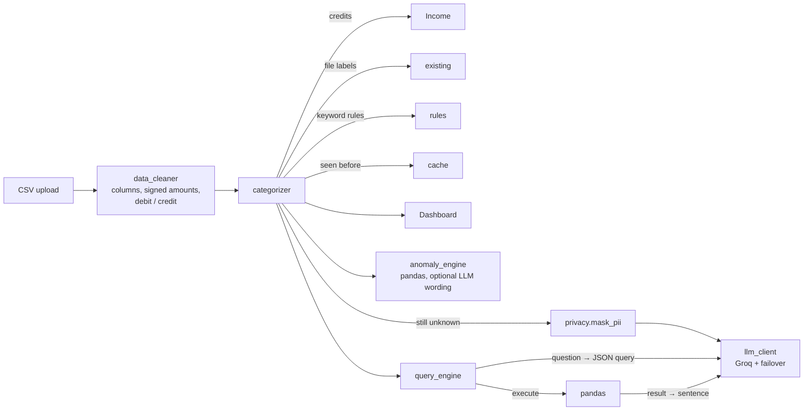

# AI Spend Insights Bot

[](https://4svb3d4a3caa4seimrygxv.streamlit.app/)
[](https://github.com/thakursamir0000-star/spend-ai-/actions/workflows/ci.yml)

A personal finance assistant that analyzes bank/UPI transaction data using LLMs. Upload a CSV, get auto-categorized spending insights, anomaly detection, and natural-language Q&A — with every number computed in pandas, personal identifiers masked before anything reaches the LLM, and a test suite plus an evaluation script that measure it.

## Features

- **Bank-statement aware CSV parsing** — auto-detects date / amount / description / merchant columns, signed amounts (`Cr`/`Dr`, `+`/`-`, brackets), separate *Withdrawal* / *Deposit* columns and DR/CR type columns. Salary and refunds are tracked as income, not spending.
- **Hybrid categorization** — valid labels from the file → whole-word keyword rules → per-transaction cache → batched, de-duplicated LLM calls. Every row records where its label came from.
- **Privacy by default** — UPI IDs, phone numbers, emails and card/account/reference numbers are masked before text is sent to the LLM.
- **Anomaly detection** — category spend spikes (>50% and ≥₹500 above the 3-month average) and new recurring merchants, measured from the latest date in your data.
- **Interactive dashboard** — spend / income / net metrics, category pie, monthly trend, category breakdown over time, top merchants.
- **NL Q&A with receipts** — ask *"How much did I spend on food last quarter?"*; the answer comes with a "How this was computed" panel showing the exact filters and result.
- **QLoRA fine-tuning** *(optional sub-project)* — a trained local Qwen2.5-1.5B + LoRA classifier for offline categorization: 0.947 accuracy on known merchants in messy statement formats (rules: 0.898). See [results](#qlora-fine-tuned-model-optional).

## Architecture



**Key design decisions**

1. **The LLM never computes numbers.** It turns the question into a structured query, pandas executes it, and the LLM only phrases the result. If phrasing fails, a deterministic template answers instead.
2. **Cheapest signal first.** Credits, existing labels, rules and the cache run before any API call; identical transactions share one LLM slot.
3. **Relative dates follow the data.** "Last month" means the month before your latest transaction, so historical statements work.
4. **One LLM gateway.** `llm_client.py` owns the model failover order and logs every failed model instead of silently skipping it.
5. **UI-free core.** The cleaning, categorization, anomaly and Q&A modules don't import Streamlit, so they are unit-tested directly.

## Evaluation

Reproduce with `python evaluate.py` (offline) or `python evaluate.py --with-llm` (needs `GROQ_API_KEY`).

| Evaluation | Rows | Rules only | Rules + LLM | Macro F1 (rules → + LLM) |
|---|---|---|---|---|
| Categorization — sample data, labels hidden | 1,417 (213 sent to LLM) | 0.905 | **0.974** | 0.841 → 0.970 |
| Categorization — bank-style descriptions, merchants unseen in training* | 776 (236 sent to LLM) | 0.799 | **0.885** | 0.751 → 0.877 |
| NL Q&A — computed number matches pandas ground truth | 14 questions | – | **13 / 14** | median 8.0 s per answer |

\* the held-out test set produced by `spend-classifier-qlora/train/build_dataset.py`; pass it with `--test-jsonl`.

Notes on the LLM run (29 Oct 2026, current code, Groq free tier, `openai/gpt-oss-20b`):
- Three batches hit the free tier's 8,000 tokens-per-minute limit and were answered by the fallback `openai/gpt-oss-120b`; every row still got an LLM label.
- **The Q&A miss is a model parsing error:** for *"Break down my Shopping spend by month"* the model returned a query with no category filter, so pandas summed all spending per month — and the phrased answer still called it "shopping". The **How this was computed** panel shows the empty filter list, which is how a user can catch it. A second run straight after answered it correctly (14/14): with temperature 0.1 answers vary between runs, and with 14 questions one answer moves the score by 7 points.
- **That second run's categorization numbers aren't reported:** `gpt-oss-20b` hit its daily token cap mid-run and the old Llama fallbacks returned 404 (Groq no longer offers them), so 83 of the 236 unseen-merchant rows got no LLM label and fell back to `Other`. That run is why the fallback chain was fixed (see [Rate limits](#models--llm-strategy)).
- **Fallback check after the fix:** a third run started with both gpt-oss models at their daily caps. Each was detected and skipped, `qwen/qwen3.8-27b` took over, and Q&A scored 14/14. On the unseen-merchant set, though, qwen's free-tier limit of 1,000 output tokens per minute let only 110 of 236 rows through the parallel batches; the other 126 fell back to `Other` (accuracy 0.822). So once both gpt-oss daily caps are spent the app keeps answering, but a large statement is only partly labelled.
- An earlier run found a bug in the evaluation itself: the ground truth for "last month" assumed the data ended in May, while it ends on 30 June. It is fixed and covered by a test.
- 14 questions is a small set; it checks the parse → pandas → phrase path, not every phrasing a user might try.

## Models & LLM Strategy

All LLM calls go through the **Groq SDK** with automatic failover:

| Priority | Model | Role |
|---|---|---|
| 1 (Primary) | `openai/gpt-oss-20b` | Categorization, Q&A parsing, anomaly phrasing |
| 2 (Fallback) | `openai/gpt-oss-120b` | Larger reasoning model |
| 3 (Fallback) | `qwen/qwen3.8-27b` | Different model family with its own rate limits; strict JSON, no reasoning text |

> **Override:** `GROQ_CATEGORIZER_MODEL` and `GROQ_QA_MODEL` set the primary model per task; `GROQ_FALLBACK_MODELS` (comma-separated) replaces the fallback list. Every failure is logged, and a model the API reports as missing (404) is skipped for the rest of the session, so a retired model ID costs one request instead of one per batch. gpt-oss models run with `reasoning_effort="low"` so the JSON answer isn't cut off, and transactions are sent in batches of 40.
>
> **Rate limits:** the Groq SDK already waits out a short 429 (it follows the server's `retry-after` up to 60 s, twice). A longer `retry-after` means a per-day token cap — on the free tier that is reached after a few full evaluation runs — so that model is skipped until the cap resets instead of being retried on every batch, and the next model in the chain takes over. Rows that no model labels fall back to `Other` and are counted in the sidebar.
>
> **Lesson learned:** the original fallbacks `qwen/qwen3.6-27b` and `groq/compound-mini` returned 404 on this account, but the old code swallowed errors, so they had silently never worked. Logging failures surfaced it on the first evaluation run. It happened again in October 2026, when Groq stopped offering `llama-3.3-70b-versatile` and `llama-3.1-8b-instant`: the logs showed the 404s on the next evaluation run, and the chain now ends with `qwen/qwen3.8-27b`.

### QLoRA Fine-Tuned Model *(optional)*

The `spend-classifier-qlora/` sub-project fine-tunes **Qwen2.5-1.5B-Instruct** with 4-bit QLoRA for transaction categorization.

**Training: complete** (rank-16 LoRA, 4 epochs, 4-bit QLoRA).

| Test set | Rules only | Rules + Groq LLM | Fine-tuned (local) |
|---|---|---|---|
| Known merchants, new statement formats (567 rows) | 0.898 | – | **0.947** (macro F1 0.928) |
| Unseen merchants (776 rows) | 0.799 | **0.885** | not measured* |

\* The adapter was trained on the original random split, which includes the unseen-merchant test merchants, so scoring it there wouldn't be fair; `build_dataset.py` now produces a merchant-held-out split for the next training run. An evaluation audit also found that the original Groq baseline was sent the gold labels; that number is withdrawn. Details in [`spend-classifier-qlora/README.md`](spend-classifier-qlora/README.md).

The deployed app uses the Groq path; switching to the local model requires the one-line swap described in the sub-project README.

## Setup

```bash
pip install -r requirements.txt

# API key — environment variable or .streamlit/secrets.toml
set GROQ_API_KEY=gsk_...

streamlit run app.py
```

Without an API key the app still runs: categorization uses rules only and Q&A is disabled.

Optional settings: `MASK_PII=false` turns off masking (debugging only); `GROQ_*_MODEL` as above.

Or with Docker (the same image the Hugging Face Space builds):

```bash
docker build -t spend-ai .
docker run -p 8501:8501 -e GROQ_API_KEY=gsk_... spend-ai
```

## Testing

```bash
pip install -r requirements-dev.txt
ruff check .
pytest
```

The tests use a fake LLM client, so they need no network or API key. They cover amount/direction parsing, bank column formats, rule matching, cache behavior, LLM failover, PII masking, Q&A filters and anomaly detection. CI runs lint, tests and the offline evaluation on Python 3.11 (pandas 2) and 3.12 (pandas 3) for every push and pull request.

## Usage

1. Upload a transaction CSV (or use the included `sample_transactions.csv`)
2. Click **Clean & Categorize** — the sidebar shows how many labels came from your file, rules, cache or the LLM
3. Explore the **Dashboard** tab
4. Click **Detect Anomalies** for spending flags and new recurring merchant alerts
5. Ask questions in the **Ask AI** tab and open **How this was computed** to check the numbers

### CSV Format

Any CSV with a date column, plus either one amount column or separate debit/credit (withdrawal/deposit) columns. Descriptions and merchants are optional but improve categorization. A column named `Category` is used when its values are among the 10 categories below; a bank `Type` column with DR/CR values sets the transaction direction.

### Categories

Spending: `Food & Dining` · `Groceries` · `Transport` · `Shopping` · `Subscriptions` · `Bills & Utilities` · `Entertainment` · `Healthcare` · `Transfers` · `Other`. Money received is labelled `Income`.

## Sample Data

`generate_sample_data.py` creates 6 months (Jan–Jun 2026) of synthetic UPI/bank transactions across 10 categories with realistic patterns (weekend dining spikes, monthly subscriptions, holiday effects):

```bash
python generate_sample_data.py
```

## Project Structure

```
├── app.py                      # Streamlit UI — Dashboard, Anomalies, Ask AI
├── data_cleaner.py             # Column detection, signed amounts, debit/credit, dates
├── categorizer.py              # Income → file labels → rules → cache → LLM
├── anomaly_engine.py           # Spike / new-merchant detection, optional LLM wording
├── query_engine.py             # Question → JSON query → pandas → answer
├── llm_client.py               # Groq calls with logged model failover
├── privacy.py                  # PII masking before LLM calls
├── evaluate.py                 # Categorization + Q&A evaluation, prints README table
├── tests/                      # pytest suite (fake LLM client, no network)
├── .github/workflows/ci.yml    # Lint, tests, offline evaluation
├── generate_sample_data.py     # Synthetic transaction generator
├── sample_transactions.csv     # Pre-generated sample data (1,417 transactions)
├── requirements.txt / requirements-dev.txt
├── Dockerfile                  # Hugging Face Space / local container
└── spend-classifier-qlora/     # QLoRA fine-tuning sub-project
    ├── train/                  # Dataset builder (merchant split), config, training + Colab notebook
    ├── eval/                   # Baseline & fine-tuned model evaluation
    └── inference/              # Local classifier + integration router
```

## Limitations

- **Synthetic data** — sample transactions come from a generator, not real bank exports; the held-out evaluation uses only 10 unseen merchants.
- **Masking is pattern-based** — it catches identifiers (UPI IDs, phone, account numbers), not personal names written as plain text.
- **10 fixed spending categories, single label** per transaction.
- **API dependency** — LLM categorization and Q&A need a Groq API key.

## License

This project is for educational and personal use.
